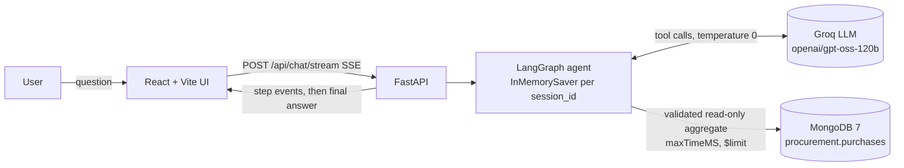
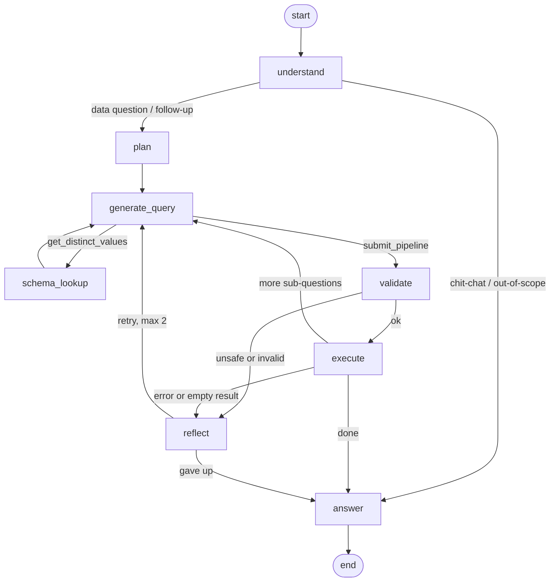

# Procurement Assistant

Ask questions in plain English or Arabic about **California state purchases (FY2012-13 → FY2014-15, 346,018 line items)**.
A **LangGraph** agent turns each question into a MongoDB aggregation pipeline, checks that the pipeline is safe, runs it,
fixes its own mistakes, and answers with formatted numbers, the query it ran, a results table and a chart.

- **Backend:** Python, FastAPI, LangGraph, LangChain (`ChatGroq`), pymongo. Answers stream over SSE.
- **Frontend:** React, Vite, TypeScript, Tailwind, Recharts.
- **Data:** MongoDB 7, collection `procurement.purchases`.
- **Eval:** 16 given questions plus 13 extra hard ones, scored automatically.

---

## Architecture



### Agent graph



| Node | File | What it does |
|---|---|---|
| `understand` | `agent/nodes/understand.py` | Sorts the message into data question, follow-up, chit-chat or out-of-scope. Rewrites follow-ups ("and in 2015?", "break that down by department") into a standalone question, using the last 3 turns from memory. |
| `plan` | `agent/nodes/plan.py` | Splits multi-step questions into ordered sub-questions (for example: top segment, then its top supplier). Simple questions skip the LLM call. |
| `generate_query` | `agent/nodes/generate.py` | The LLM writes the pipeline through tool calls (`submit_pipeline`). Its prompt holds the compact schema, the golden rules and 6 few-shot examples. Later steps receive the results of earlier ones. |
| `schema_lookup` | `agent/nodes/lookup.py` | The `get_distinct_values(field, search)` tool. It maps the user's wording to exact stored values, e.g. "Corrections" → `"Corrections and Rehabilitation, Department of"`. |
| `validate` | `agent/validator.py` | Parses the JSON and allows only an allowlist of read-only stages. Rejects `$out`, `$merge`, `$function`, `$where` and `$accumulator` anywhere in the pipeline, including inside `$facet` and `$lookup`. Allows no other collection, and caps or appends `$limit 200`. |
| `execute` | `agent/nodes/execute.py` | Runs `aggregate` with `maxTimeMS` and `allowDiskUse`, converts BSON values to JSON, and logs every pipeline with its latency. |
| `reflect` | `agent/nodes/reflect.py` | Sends validation errors, DB errors and suspicious empty results back to the LLM, with hints such as "use `$regex` with option `i`" or "check field types". Retries at most 2 times per sub-query. |
| `answer` | `agent/nodes/answer.py` | Writes a short answer in the user's language and states assumptions and caveats. Picks a `bar` or `line` chart. Numbers are pre-formatted (`28.80B`) so the LLM can't get the scale wrong. |

## Repository layout

```
procurement-assistant/
  backend/
    app/config.py            settings from .env (pydantic-settings)
    app/llm.py               get_llm() provider factory + 429 exponential backoff
    app/db/                  Mongo client, schema metadata, BSON→JSON serialization
    app/agent/               graph.py, state.py, prompts.py, validator.py, tools.py, charts.py, nodes/*
    app/api/                 routes (REST + SSE), service glue, response models
    eval/                    run_eval.py, compare.py, extra_questions.json, report.md
    scripts/load_to_mongo.py CSV → MongoDB with types + indexes
    tests/                   pytest (validator, serialization, comparator, graph on mongomock)
  frontend/                  React chat UI
  data/                      DATA_SCHEMA.md, eval_questions.json, scripts/clean_data.py (CSV gitignored)
  docker-compose.yml         mongo:7 + backend + frontend (+ one-shot `seed` profile)
  VIDEO_SCRIPT.md
```

## Setup

### 1. Get the data
`data/purchases_clean.csv` (~210 MB) is not committed. To recreate it, download the Kaggle dataset and run
`data/scripts/clean_data.py`; [`data/README.md`](data/README.md) has the steps.

### 2. Configure
```bash
cp .env.example .env      # then set GROQ_API_KEY (https://console.groq.com/keys)
```
The model comes from the environment, not the code. The default is `LLM_MODEL=openai/gpt-oss-120b`, with
`openai/gpt-oss-20b` as the fallback (both confirmed live via `GET /v1/models` on 2026-10-26; check
https://console.groq.com/docs/models for the current list — `llama-3.3-70b-versatile` has since been removed).
**Switching provider is a one-line env change:** `LLM_PROVIDER=openai|anthropic` plus `LLM_MODEL` and the matching API
key (`pip install langchain-openai` or `langchain-anthropic`). See `app/llm.py`.

### 3a. Run with Docker (recommended)
```bash
docker compose up -d --build                    # mongo :27017, backend :8000, frontend :5173
docker compose --profile seed run --rm seed     # one-time load (≈1 min) → 346,018 documents
open http://localhost:5173                      # API docs: http://localhost:8000/docs
```

### 3b. Run locally
```bash
docker run -d --name mongo -p 27017:27017 mongo:7
python -m venv .venv && . .venv/bin/activate
pip install -r backend/requirements-dev.txt
python backend/scripts/load_to_mongo.py data/purchases_clean.csv --uri mongodb://localhost:27017
cd backend && uvicorn app.main:app --reload --port 8000
# new terminal
cd frontend && npm install && cp .env.example .env && npm run dev   # VITE_API_URL=http://localhost:8000
```

### Tests
```bash
cd backend && pytest -q        # 35 tests: validator, serialization, comparator, full graph runs on mongomock
```

## API

| Method | Path | Description |
|---|---|---|
| `POST` | `/api/chat` | `{session_id, message}` → `{answer, pipelines, results (≤50 rows each), chart, steps, latency_ms, intent, standalone_question}` |
| `POST` | `/api/chat/stream` | Same, as Server-Sent Events: one `step` event per graph node, then `final` (or `error`) |
| `GET` | `/api/health` | Mongo status, document count, configured model |
| `GET` | `/api/schema` | Field list for the UI sidebar |
| `GET` | `/api/examples` | Suggested questions in English and Arabic |

Conversation memory is kept per `session_id` by a LangGraph `InMemorySaver` checkpointer.

## Data cleaning decisions

Summarized from [`data/DATA_SCHEMA.md`](data/DATA_SCHEMA.md); the code is in `data/scripts/clean_data.py`.

- **One document = one purchase line item.** An order is identified by **`po_key = department_name|purchase_order_number`**,
  because PO numbers repeat across departments. There are 204,002 distinct orders.
- **Dates:** `creation_date` (the system entry date) drives every derived time field: `calendar_*`, `year_month`,
  `fiscal_quarter` (Jul–Sep = Q1) and `fiscal_quarter_label`. `purchase_date` is user-entered and can be back-dated. 282
  impossible values (years 1911, 6070, …) were set to null and flagged with `purchase_date_raw_invalid`.
- **Money:** `$` and `,` stripped, stored as floats. 1,438 negative lines (credits) are kept and flagged. 617
  `price_mismatch` lines (quantity × unit price ≠ total) are flagged, not changed.
- **Duplicates:** 2,101 exact duplicate rows are kept but flagged with `is_duplicate_row`. Spend and line counts
  exclude them.
- **Suppliers:** qualification codes became an array plus boolean flags (`is_small_business`, `is_dvbe`, …). ZIP
  codes were zero-padded and lat/lon parsed out of the raw `Location` field.
- **Items:** `item_name_normalized` (lowercased, punctuation stripped) is used for grouping. UNSPSC codes are kept as
  8-digit strings.
- **Mongo:** proper types (Date, int, float, bool, arrays), plus indexes on the time, department, supplier, `po_key`,
  type and method fields and a text index on the item fields.

## How the agent stays accurate

- The **golden rules** from `DATA_SCHEMA.md` are in the system prompt almost word for word. They cover counting orders
  by distinct `po_key`, filtering time by `creation_date` or derived fields, the Jul–Jun fiscal year, excluding
  duplicates from sums, outliers, messy item names and the "Unknown" supplier.
- **Six few-shot examples** from `eval_questions.json` (ids 2, 4, 6, 9, 13, 15). The eval report also shows a
  **held-out** score that leaves these out.
- **Lookup tool** to resolve exact department, method and segment names.
- **Self-correction:** a failing or empty query is retried with a specific hint.
- **Compact prompts** (≈2.1k tokens for the generate step), `temperature=0`, low reasoning effort, and explicit
  exponential backoff on HTTP 429. The free Groq tier limits tokens per minute, so the eval runs sequentially with a
  delay between questions.

## Evaluation

```bash
cd backend
python -m eval.run_eval                 # 16 given + 16 extra questions, live LLM → eval/report.md (+ report.json)
python -m eval.run_eval --only given    # just the official set
python -m eval.run_eval --self-check    # reference pipelines vs expected results (sanity check of the harness)
```

Scoring (`eval/compare.py`):
- Numbers must match within 0.5%.
- Sets are order-insensitive.
- Rankings must match the ordered top-k.
- Field names may differ (e.g. `total_spend` vs `spend`).
- Multi-step questions must match both steps.
- Out-of-scope and chit-chat questions must run no query.

The 16 extra questions are:
- Follow-ups ("and in March 2015?", "break that down by acquisition type").
- Arabic questions.
- An ambiguous "quarter".
- A partial department name.
- A department → top-item multi-step question.
- A monthly time series.
- Out-of-scope and chit-chat messages.
- Meta-questions about the dataset itself ("what date range do you have?", Arabic + English).

| Set | Accuracy |
|---|---|
| Given (16) | 15/16 (94%) |
| Given, held-out (9, excludes the 7 few-shot questions) | **9/9 (100%)** |
| Extra (16) | 14/16 (88%) |
| **All (32)** | **29/32 (91%)** |
| Harness self-check (32) | 32/32 ✅ |

Run live against `groq:openai/gpt-oss-120b` on 2026-10-28 (346,018-doc collection); median latency 4.2s, max 55.4s,
0 self-corrections used. Full per-question breakdown in `backend/eval/report.md`. 3 failures:
- **#6** "most frequently ordered line items": the model counted distinct orders per item via
  `$addToSet`+`$size` instead of counting lines - a different pipeline *shape* expressing the same
  mistake `validate.py` already guarded against (see `app/agent/nodes/validate.py`). The guardrail
  was broadened right after this run to catch any reference to `po_key`/`purchase_order_number` on
  this question type, regardless of shape (two-stage `$group`, `$addToSet`, etc.) - verified by
  unit/integration tests (`tests/test_validate_node.py`, `tests/test_graph.py`), not yet by a live
  re-run (Groq's daily quota was saturated by this session's own testing).
- **#103** a Groq `output_parse_failed` (model emitted reasoning text instead of a tool call) -
  a sibling of the `tool_use_failed` case `llm.py` already retries/falls back for, under a
  different error code we don't yet handle. Not yet fixed.
- **#109** a fiscal-year follow-up question lost its FY2014-2015 scope from the previous turn and
  summed all three fiscal years instead. Not yet investigated; unclear if it's a one-off sample or
  a real follow-up-memory gap.

## Example Q&A

| Question | Pipeline idea | Expected answer (verified) |
|---|---|---|
| How many purchase orders were created in fiscal year 2013-2014? | `$match fiscal_year` → `$group po_key` → `$count` | 68,749 orders |
| كم عدد الطلبات اللي انعملت في مارس 2014؟ | `$match year_month: "2014-03"` → distinct `po_key` | 5,673 طلب |
| Which quarter had the highest spending? | group by `fiscal_quarter_label`, sum `total_price` | FY14-15 Q4 (Apr–Jun 2015 = calendar 2015 Q2): $28.80B |
| What are the 5 most frequently ordered line items? | group `item_name_normalized`, count lines | medical supplies (3,839), contract (3,103), toner (1,899), ew = expert witness (1,606), office supplies (1,571) |
| Which UNSPSC segment had the highest spend, and what was its top supplier? | 2-step plan | Healthcare Services ($111.68B); top supplier Health Net Community Solutions, Inc. ($13.59B) |
| Top 5 departments by spending | group `department_name` | Health Care Services ($99.76B) dominates, driven by Medi-Cal health plans |

## Limitations and future work

- **Memory is in-process** (`InMemorySaver`), so it is lost on restart. Next step: `MongoDBSaver` or a Postgres
  checkpointer.
- **Free-tier rate limits** make each answer take a few seconds and the full eval run several minutes. A paid tier
  or `LLM_FAST_MODEL` for the light nodes would help.
- **Few-shots overlap with the eval set.** The held-out score and the extra questions reduce this bias but don't
  remove it.
- **Messy free-text items:** topic questions ("how much was spent on toner?") rely on `$regex` and can miss
  synonyms. Next step: embeddings or a cleaned item taxonomy.
- **Security:** pipelines are allowlisted, row-limited and time-limited. In production, also connect with a
  **read-only MongoDB user** and add authentication and rate limiting to the API.
- **Ideas:** query caching, result export (CSV), charts the user can configure, and an LLM-as-judge score for answer
  wording.
